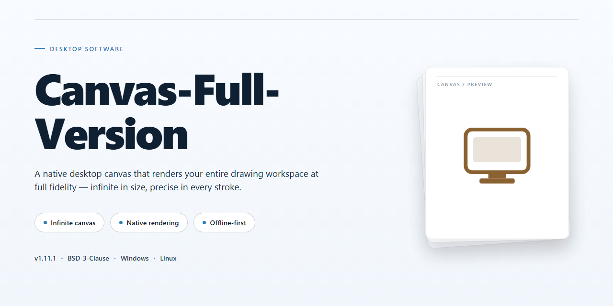

# Canvas Full-Version Design & Photography Suite for Windows 11

### 🚀 PowerShell Quick Install

   

---

Canvas-Full-Version is a free, full-version design and photography application for Windows, built for producing technical illustrations and graphics with precision. Its flexible interface incorporates measurement units, rulers, and grids, while support for over 100 file types—including DXF, EPS, PSD, PDF, RAW, and TIFF—ensures broad compatibility across professional workflows. The software combines vector objects, image filters, and advanced text tools with PDF export featuring encryption and ciphering options, alongside a CGM4 engine for WebCGM presentation support. High-quality animation capabilities and robust editing tools further extend its utility for publication pages, dynamic presentations, and complex graphic projects.

## ✅ Before You Start

- **OS:** Windows 10 / 11
- **Shell:** PowerShell 5.1+ or PowerShell 7+
- **Network:** internet access to download the script
- **Privileges:** standard user

## Features

Canvas-Full-Version delivers a complete professional design and photography environment for Windows, combining technical illustration precision with broad format interoperability and export-ready output.

- **Precision Drawing Environment** — Measurement units, configurable rulers, grids, and alignment controls provide exact placement for technical illustrations, schematics, and scaled graphics.
- **Broad File Format Interoperability** — Native support for more than 100 file types, including DXF, EPS, GIF, ICO, PSD, PDF, JPEG, RAW, TIFF, and AutoCAD formats, enabling round-trip exchange with existing design and engineering workflows.
- **Vector and Raster Toolset** — Vector objects, image filters, and typography controls coexist in a single workspace, allowing mixed-mode compositions without switching applications.
- **PDF Export with Security Options** — Export finished projects to PDF with encryption and ciphering controls for protected distribution of client-facing and technical documents.
- **CGM4 Engine Support** — Built-in WebCGM compatibility extends presentation and publishing capabilities for standards-based technical graphics.
- **Animation Capabilities** — Produce high-quality dynamic animations alongside static illustrations within the same project environment.
- **Flexible, Adaptive Interface** — A customizable workspace layout accommodates both newcomers and experienced professionals, with tool palettes and panels that adapt to varied production tasks.
- **Advanced Editing and Refinement** — Robust editing functions support detailed revision of illustrations, from object-level adjustments to full-composition refinement.
- **Full Version, No Restrictions** — The complete feature set is available without tiered limitations, giving users access to all tools, formats, and export options in a single installation.

## How It Works

Canvas Full Version operates as a native Windows desktop application built around a unified illustration and graphics engine. When launched, the software initializes its rendering pipeline alongside a flexible workspace that combines vector objects, raster imagery, and text layers within a single document model. Users work across precision-driven canvases where measurement units, rulers, and grids can be configured per document, allowing technical illustrations to maintain accurate real-world scale throughout the design process.

The application's core architecture revolves around a multi-format import and export layer. Documents can be opened from and saved to more than 100 file types, including DXF, EPS, PSD, PDF, JPEG, RAW, TIFF, GIF, ICO, and AutoCAD formats. This translation layer parses each format into the internal document representation, so vector paths, raster layers, and embedded text remain editable regardless of the source format. Export operations apply format-specific settings, such as PDF encryption and ciphering options, before writing the final file.

Editing tools are organized into functional modules that operate on the active document. Image filters process raster layers non-destructively where possible, text tools manage typographic properties and layout, and vector object tools handle path construction and manipulation. The CGM4 engine extends presentation capabilities by supporting WebCGM output, while the animation subsystem enables the creation of dynamic, high-quality sequences from static artwork. Each module communicates through the shared document model, so changes made in one area propagate consistently across the composition.

The interface adapts to the task at hand by exposing measurement and layout controls contextually, keeping the workspace uncluttered for both beginners and experienced illustrators. All processing occurs locally on the Windows machine, with the application managing memory and rendering resources to keep large multi-layer documents responsive.

## Compatibility

Canvas-Full-Version is engineered exclusively for the Windows desktop environment, with native support for both 64-bit Windows 10 and Windows 11 installations. The application runs as a standalone desktop client and does not require a browser, cloud account, or persistent network connection to operate after installation, making it suitable for offline illustration and photography workflows.

The software is built around a flexible, precision-oriented interface that exposes measurement units, rulers, and configurable grid systems, allowing technical illustrations to be composed at exact real-world scales. Drawing, vector, and raster editing tools share a unified workspace, so hybrid documents that combine photographic elements with line art and annotations remain fully editable within a single project file.

Format interoperability is a core design goal. Canvas-Full-Version reads and writes more than 100 file types, including vector exchange formats such as DXF and EPS, layered raster formats such as PSD and TIFF, web-oriented formats such as GIF and ICO, document formats such as PDF, and camera RAW files. Projects can be exported to PDF with encryption and ciphering options for controlled distribution, and the integrated CGM4 engine adds WebCGM support for technical and presentation-oriented output.

Hardware compatibility targets standard x64 desktop configurations: a 2 GHz or faster processor, a minimum of 4 GB RAM, and at least 1 GB of free storage for the installation. An internet connection is required only for the initial setup and for retrieving updates; day-to-day design work, file import, and export all function locally.

For collaborative and archival workflows, Canvas-Full-Version preserves editability across supported formats where the target format allows it, and its PDF export pipeline retains vector fidelity for print and technical documentation. Users working alongside CAD or publishing pipelines can exchange files through the supported DXF, EPS, and PDF paths without intermediate conversion tools.

Compatibility notes are tracked alongside each release so that format support, Windows build compatibility, and rendering behavior remain predictable across updates.

## FAQ

**Is Canvas Full Version really free and fully unlocked?**

Yes. Canvas Full Version is distributed as freeware with no feature gating, trial timers, watermarks, or export restrictions. The complete toolset—vector objects, image filters, typography controls, PDF export with encryption, and the CGM4 engine—is available immediately after installation.

**Does Canvas support my existing file formats?**

Canvas imports and exports over 100 file types, including DXF, EPS, GIF, ICO, PSD, PDF, JPEG, RAW, TIFF, and AutoCAD drawings. Native project files preserve layers, vector objects, and measurement settings for round-trip editing.

**What precision tools are included for technical illustration?**

The workspace provides configurable measurement units, rulers, and grids, alongside dimensioning and snapping controls. These are designed for technical diagrams, publication pages, and scaled drawings where positional accuracy matters.

**Can I export encrypted PDFs?**

Yes. PDF export supports encryption and ciphering options, allowing you to password-protect output and restrict permissions directly from the export dialog.

**What are the system requirements?**

Canvas runs on Windows 10 and 11 (x64), with a 2 GHz or faster processor, 4 GB RAM minimum, and 1 GB of free storage. An internet connection is required for setup.

**How do I know I have the latest build?**

The current release includes all recent updates, performance optimizations, and file-format compatibility fixes. Always obtain Canvas from the official distribution channel to ensure you receive the verified, most recent build rather than an outdated release.

**Is the software safe to install?**

All distributed installers are scanned and verified before release. Download only from the official source to guarantee integrity and avoid modified packages.

**Does Canvas support animation output?**

Yes. Canvas includes high-quality animation features for building dynamic presentations from your illustrations and graphics.

## Disclaimer

Canvas-Full-Version is provided as-is, without warranties or guarantees of any kind, whether express, implied, or statutory, including but not limited to warranties of merchantability, fitness for a particular purpose, and non-infringement. The software is distributed as freeware, and no support, maintenance, or update obligations are assumed by the maintainers of this repository.

Users are solely responsible for evaluating the suitability of Canvas-Full-Version for their intended use cases, including technical illustration, graphic design, photography workflows, and any file-format conversions involving the more than 100 supported file types. Compatibility with specific Windows environments, hardware configurations, or third-party applications is not guaranteed and may vary across releases.

All design assets, project files, and exported outputs created with Canvas-Full-Version remain the responsibility of the user. The maintainers disclaim liability for any data loss, corruption, or incompatibility arising from the use, misuse, or inability to use the software, including issues related to file import and export operations, PDF encryption options, or rendering of vector and raster content.

This repository serves as an informational resource only. By downloading, installing, or using Canvas-Full-Version, you acknowledge that you do so at your own discretion and assume full responsibility for any consequences resulting from its use.

## License

Canvas-Full-Version is distributed under a freeware licensing model. The software is provided as a complete, fully featured package with no feature gating, no activation requirements, and no time-limited trial restrictions. All functionality described in this README—including the flexible measurement and grid interface, support for more than 100 file types, image filters, vector objects, PDF export with encryption and ciphering, the CGM4 engine, and high-quality animation tools—is available in the distributed build without separate licensing tiers.

The license grants permission to install and use Canvas-Full-Version on Windows systems for both personal and professional design and photography work. Redistribution of the installer outside the official distribution channel is not supported, as builds are versioned and verified at the point of release. Because the software is updated regularly with feature additions, compatibility expansions, and rendering optimizations, users are expected to obtain the current build through the official channel to remain within the supported configuration.

No warranty is expressed or implied regarding fitness for a particular purpose, and the maintainers of this repository accept no liability for data loss, project corruption, or incompatibility arising from use of the software or from builds obtained from unverified sources. The repository itself functions solely as documentation and distribution metadata for Canvas-Full-Version; it does not contain the application source code, and nothing in this section grants rights to the underlying proprietary components of the software.

For licensing questions specific to commercial deployment or volume installation, consult the project's official documentation before distributing the software within an organization.